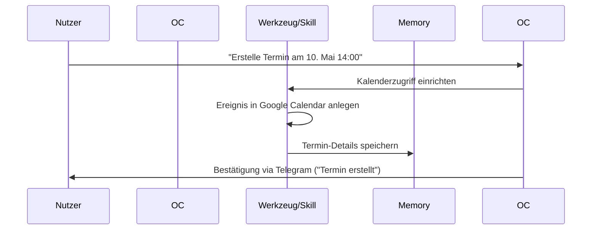
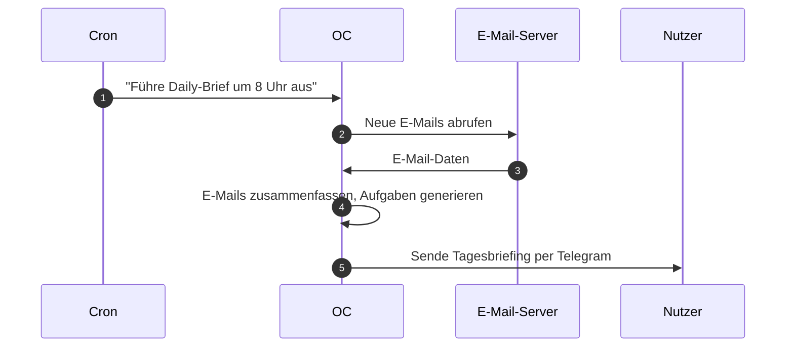

# Executive Summary  
OpenClaw ist ein quelloffener, lokal betreibbarer KI-Agent, der als „immer-an“-Assistent fungiert und Nutzer durch automatisierte Aktionen in bekannten Kommunikationskanälen (WhatsApp, Telegram, Slack, etc.) unterstützt【8†L553-L561】【31†L48-L56】. Praktische Anwendungsfälle reichen von E-Mail-/Kalender-Management und täglichen Briefings über Software-Entwicklung und Web-Automatisierung bis hin zu Smart-Home-Steuerung und persönlichem Wissensmanagement. Viele Nutzer loben die **Flexibilität** und **Vielseitigkeit** des Systems (z.B. Multi-Channel-Integration, persistente Gedächtnisse, Skriptbarkeit), während Kritiker auf die **Komplexität**, **Stabilitätsprobleme** und **Sicherheitsrisiken** hinweisen. Im Folgenden stellen wir die Top-20-Anwendungsfälle anhand typischer Workflows und Personas dar sowie die 20 am häufigsten genannten Vorzüge (“Loved”) und Nachteile (“Hated”). Die Daten stammen aus offiziellen Quellen, Community-Foren und Projekt-Beispielen.  

## Top 20 reale Anwendungsfälle für OpenClaw  
| **Use Case**                         | **Persona (Nutzerprofil)**        | **Typischer Workflow**                                                                                              | **Häufigkeit/Rating**        | **Beispiel/Referenz**                                           |
|--------------------------------------|-----------------------------------|--------------------------------------------------------------------------------------------------------------------|------------------------------|-----------------------------------------------------------------|
| **1. E-Mail-Management und Inbox-Clearing**  | Privatpersonen, Büroangestellte, kleine Unternehmen | OpenClaw liest E-Mails (z.B. via Gmail-Skill), filtert Spam, fasst Kernaussagen zusammen und schreibt bei Bedarf Antwort-E-Mails oder Erinnerungen. | Hoch (Routineaufgabe)        | @dreetje lässt OpenClaw seinen Posteingang säubern und Erinnerungen versenden【12†L8-L15】. |
| **2. Kalender- und Terminverwaltung**      | Berufstätige, Projektmanager      | OpenClaw plant Termine: basierend auf Prioritäten ordnet es Aufgaben automatisch im Kalender ein, sendet Einladungsemails oder Warnungen bei Konflikten.          | Hoch                         | @danpeguine lässt OpenClaw Termine zeitlich blocken und Konflikte klären【12†L16-L25】.      |
| **3. Persönlicher Assistent / Daily Briefing** | Vielbeschäftigte, Führungskräfte   | Tägliche Cron-Job-Abfragen (z.B. Wetter, Kalender, To-Do-Liste, E-Mail-Zusammenfassungen) werden von OpenClaw gesammelt und morgens in einer Nachricht gepusht. | Hoch                         | @danpeguine erhält von OpenClaw morgens Briefings mit Wetter, Meetings und Zielen【12†L16-L25】. |
| **4. Aufgaben- und Projektplanung**         | Entwickler, Teamleiter, PMs      | Zielsetzung in natürlicher Sprache (z.B. „Plane den Sprint“), OpenClaw erstellt Tasks in Trello/Jira, bricht große Projekte in To-Do-Listen herunter und verwaltet Sub-Agents. | Mittel                       | OpenClaw erstellt automatisch Aufgaben für Projekte („skill builds surprise apps overnight“【14†L296-L304】).|
| **5. CRM und Kontaktmanagement**            | Vertrieb, KMU-Inhaber            | E-Mails und Kalenderkontakte werden analysiert; OpenClaw pflegt ein lokales Adressbuch, erinnert an Follow-Ups und erstellt Profile mit Gesprächshistorie.       | Mittel                       | Implementierung eines lokalen CRM mit OpenClaw (z.B. “Local CRM Framework”【15†L369-L372】). |
| **6. Content-Erstellung und -Bearbeitung**   | Blogger, Content-Manager         | OpenClaw generiert Texte (Blog, Newsletter, Notizen) oder Grafiken auf Anforderung, überarbeitet Entwürfe und übernimmt Content-Pipelines (z.B. YouTube-Ideen, Podcast-Shows). | Mittel                       | OpenClaw half beim Erstellen von Webseite (Notion → Astro) und Podcast-Show-Notizen【12†L52-L54】【14†L302-L310】. |
| **7. Code-Generierung und -Review**         | Entwickler, DevOps               | OpenClaw führt Code-Review durch, generiert Boilerplate oder Tests, pusht Pull-Requests; es reagiert auf Build-Fehler via Cron oder Webhooks und kann selbst Patches erstellen. | Mittel–Hoch                  | @georgedagg_ ließ OpenClaw Code-Builds überprüfen, Fehler beheben und Deployments durchführen【12†L72-L81】. |
| **8. Web- und Daten-Automatisierung**        | Entwickler, Admins               | Automatisierte Web-Scraping-Tasks oder API-Calls: z.B. Überwachung von Websites, Sammeln von Social-Media-Beiträgen, Erstellen von Dashboards via Browser-Tools.  | Mittel                       | @andrewjiang ließ einen Agenten 4 Mio. X-Posts analysieren【12†L37-L40】; GA4-Analysen mit neuem Skill【12†L59-L63】. |
| **9. Social-Media- und Kommunikations-Automation** | Marketing, Social Media Manager   | OpenClaw postet und interagiert auf Twitter/Instagram (via Skill „TweetClaw“), beantwortet automatisch Kundenanfragen über Chat (WhatsApp, Telegram), führt Umfragen durch. | Niedrig–Mittel               | Automatisches Twittern und Retweeten mit dem TweetClaw-Plugin【14†L281-L290】. |
| **10. Multi-Channel Support / Chatbot**      | Kundensupport, Helpdesk-Teams    | Zusammenführung von WhatsApp, E-Mail, Messenger in einem KI-Postfach, automatisches Beantworten häufiger Anfragen oder Weiterleiten an Mitarbeiter.             | Niedrig–Mittel               | Konzept einer 24/7 KI-Kundenbetreuung über Telegram/Slack/E-Mail【14†L323-L332】. |
| **11. Smart Home und IoT-Steuerung**         | Technikaffine Anwender, Familien | OpenClaw verbindet sich mit Smart-Home-Geräten (Homey, Fastmail, Air Purifier). Nutzer gibt Sprach- oder Chat-Befehle („Schalte Heizung an“), Agent führt automatische Regelungen (Luftreiniger basierend auf Gesundheitsdaten). | Niedrig                      | @iannuttall verband OpenClaw mit Smart-Home-Systemen; @antonplex steuerte Luftreiniger basierend auf Biomarkern【3†L143-L151】【1†L65-L73】. |
| **12. Health-Tracking und Lifestyle**        | Gesundheitsbewusste, Selbstoptimierer | Erfassung von Gesundheitsdaten (Schlaf, Ernährung, Bewegung) aus Wearables; OpenClaw erkennt Muster (z.B. Sucht-/Stress-Triggers) und gibt proaktive Empfehlungen oder erinnert an Vorsätze. | Niedrig–Mittel               | Beispiel „Health & Symptom Tracker“: Nutzer protokolliert Symptome, Agent analysiert Auslöser【14†L331-L339】. |
| **13. Lernen und Wissensmanagement**         | Studierende, Forscher            | OpenClaw fasst Lerninhalte zusammen (Bücher, Vorlesungstranskripte), beantwortet Fragen zu Dokumenten; es erstellt eigene Wissensdatenbanken (RAG) mit Semantic Search.         | Niedrig–Mittel               | „Second Brain“-Ansatz: Alles an den Bot senden und später durchsuchen【14†L361-L367】. |
| **14. Forschungs- und Ideen-Discovery**      | Gründer, Produktmanager          | OpenClaw durchsucht Foren und Social Media (Reddit, X) nach Produktideen oder Problemstellungen, analysiert Trends, validiert Konzepte automatisch gegen Marktdaten.          | Niedrig                      | Skizziert im „Market Research & Product Factory“-Usecase【15†L383-L392】. |
| **15. Meeting-Organisation und -Protokoll**   | Teams, Manager                   | Nach Besprechungen transkribiert OpenClaw Meetings, extrahiert Action-Items und legt Aufgaben in Jira/Trello an; automatisiert Nachfass-E-Mails für Teilnehmer.            | Niedrig–Mittel               | „Automated Meeting Notes & Action Items“-Workflow【14†L355-L362】. |
| **16. Reisemanagement**                      | Vielreisende, Geschäftsleute     | OpenClaw checkt ein bei Flügen, findet Hotels, verwaltet Reiserouten und erinnert an Check-Ins. Es kann Reisepläne basierend auf Outlook/Google-Daten erstellen.            | Niedrig                      | Aus Showcase: Agent befragt mehrere Anbieter zur Flugbuchung, generierte CLI-Tool【3†L102-L109】. |
| **17. Familien- und Haushaltsorganisation**   | Eltern, Familienmanager          | Aggregation von Familienkalendern, Einkaufsliste-Organisation, Essensplanung (Rezeptvorschläge, Einkaufslisten). OpenClaw erinnert gemeinsam an Termine oder Aufgaben.    | Niedrig                      | @stevecaldwell baute wöchentlichen Essensplan in Notion mit automatischem Einkaufszettel【12†L83-L92】. |
| **18. Kreative Projekte (z.B. Grafik, Video)** | Designer, YouTuber, Podcaster    | OpenClaw erstellt bzw. editiert Medieninhalte: z.B. generiert personalisierte Meditationen (Audio/Video), Zeichen-Workflows (Flowcharts via Excalidraw), Podcast-Notizen.   | Niedrig                      | @swiftlysingh generierte Diagramme per Textauftrag; @dreetje ließ PDF-Zusammenfassungen seiner Chat-Verläufe erstellen【12†L35-L40】【12†L8-L15】. |
| **19. Automatisiertes Testing/Qualitätssicherung** | Entwickler, QA-Ingenieure        | OpenClaw führt automatisiert Tests aus (Unit, Integration) und analysiert Fehler, gibt Verbesserungsvorschläge oder erstellt PRs zur Fehlerbehebung.                        | Niedrig–Mittel               | @dreetje nutzte OpenClaw, um Tests zu „fixen“ und PRs automatisch zu öffnen【3†L49-L57】. |
| **20. IoT-/Geräte-Integration (Sonstige)**    | Tech-Enthusiasten               | Jeder maßgeschneiderte Anwendungsfall mit vorhandenem Interface: z.B. Hausautomation, Bürogeräte, Telekommandos per Telegram. Agent schickt bei Bedarf Telefonanrufe.    | Niedrig                      | OpenClaw führte Telefonanrufe durch (Reminders) und steuerte 1Password-Vault【3†L143-L151】【12†L13-L15】. |

*Hinweis:* Die Beispiele stammen aus Community-Reports und Showcase-Einträgen【12†L8-L15】【14†L323-L332】. Die Spalte *Häufigkeit* ist subjektiv eingeschätzt (hoch = weit verbreitet, niedrig = eher spezialisiertes Projekt).

*Mermaid-Diagramm: Beispiel-Workflow für Terminplanung (Chat-Eingabe → Agent → Tool → Datenbank → Antwort)*

*Mermaid-Diagramm: Beispiel „Daily Briefing“-Workflow (geplanter Cron-Job → Agent → Verarbeitung → Benachrichtigung)*

## Top 20: Was Nutzer an OpenClaw lieben („Loved“)

| **Aspekt**                          | **Verbreitung** | **Begründung & Beispielzitat**                                                                                 |
|-------------------------------------|-----------------|---------------------------------------------------------------------------------------------------------------|
| **Open Source & Datenhoheit**       | Hoch            | Da OpenClaw lokal läuft, bleiben Daten auf dem eigenen Rechner. Nutzer loben, dass „Daten und Skills auf **deinem Computer**“ liegen – kein geschlossenes System【31†L48-L56】. |
| **Multi-Channel-Integration**       | Hoch            | OpenClaw antwortet in allen genutzten Messengern (WhatsApp, Telegram, Slack, etc.)【8†L553-L561】. Ein Nutzer beschreibt, der Assistent fühle sich an wie „ein weiterer Kontakt“ im Chat【31†L52-L56】. |
| **Persistentes Gedächtnis**         | Hoch            | Anders als simple Chatbots speichert OpenClaw fortlaufend Kontext. Ein Anwender: „[Claude Code] erinnert sich nicht zwischen Sessions, OpenClaw schon“ (Kategorien, Muster über Tage【21†L171-L179】). |
| **Selbstanpassung und Erweiterbarkeit** | Hoch        | Benutzer können eigene „Skills“ (Fähigkeiten/Plugins) erstellen und das System sogar per Chat umprogrammieren【31†L59-L67】. Beispielsweise baute ein User in Minutenschnelle einen GA4-Analytics-Skill und stellte ihn öffentlich im ClawHub zur Verfügung【12†L59-L63】. |
| **Vielseitige Werkzeuge (Tools)**   | Mittel–Hoch     | OpenClaw kommt mit vielen eingebauten Tools (Browser, Dateizugriff, WebCam, Screen Rec, Kalender)【9†L729-L739】【9†L765-L773】. So kann ein Agent z.B. Webseiten steuern oder Screenshots aufnehmen. |
| **24/7-Betrieb und Proaktivität**   | Mittel          | Anders als ChatGPT läuft OpenClaw ständig; Nutzer nutzen Cron-Jobs, Erinnerungen und „Heartbeat“, damit der Assistent proaktiv tätig wird【9†L725-L733】. Beispiel: Das System weckt den Nutzer mit einem täglichen Briefing, auch wenn er schläft【21†L171-L179】. |
| **Lernfähigkeit und Persistenz**    | Mittel          | Die Fähigkeit, Ergebnisse zu speichern und später abzurufen, beeindruckt Nutzer. „Es lernte aus dem letzten Sprint und erinnert an Muster“ – Kontext geht über einzelne Interaktionen hinaus【21†L171-L179】. |
| **Reiche Community & Ökosystem**    | Mittel          | Viele Skills und Beispiele werden geteilt (z.B. ClawHub, OpenClaw-Forum). Dies ermöglicht einen „Crowd“-Effekt: ein Entwickler findet eine existierende Lösung oder Inspiration für sein Problem【12†L59-L63】【14†L279-L287】. |
| **Benutzerfreundliches Interface**  | Mittel          | Zwar CLI-basiert, doch Chat-Interface in bekannten Apps erscheint vielen ansprechend. Ein Nutzer: „vom Handy aus alles steuern“ – OpenClaw verhält sich wie ein Chatbot, nicht wie komplexe Software【31†L52-L56】. |
| **Starke KI-Integration**           | Mittel          | OpenClaw erlaubt nahtlose Nutzung großer Modelle (Claude, GPT-5.4) und Sprung zu lokalem KI-Betrieb (z.B. Ollama). Anwender schätzen die Anpassung an beste verfügbare KI【8†L584-L592】【36†L157-L166】. |
| **Automatisierung von Routineaufgaben** | Mittel      | Nutzer lieben, dass OpenClaw „einfache, wiederkehrende Tasks automatisch erledigt“ (E-Mail-Sortierung, Terminabgleich). Das gibt Zeit für wichtigere Aufgaben【12†L8-L15】【12†L48-L53】. |
| **Sicherheit durch lokale Ausführung** | Mittel       | OpenClaw vermeidet Datenweitergabe an Big Tech. Trotz Sicherheitsdebatte loben einige, dass Schlüssel lokal bleiben (im Gegensatz zu Cloud-Apps)【31†L48-L56】. |
| **Fortschrittliche Features**       | Gering–Mittel   | Features wie Sprachsteuerung (Voice Wake, Talk Mode) und Live-Canvas-Visualisierung heben es hervor【9†L695-L703】. Nutzer nennen das „Next-Level“-Funktionen, die es so woanders nicht gibt. |
| **Fähigkeit zur Selbstverbesserung** | Gering–Mittel  | OpenClaw kann sich selbst optimieren (via Codex CLI oder Chat). Ein Nutzer betont: „Du kannst den Assistenten auffordern, sein eigenes Verhalten anzupassen und zu lernen“【31†L59-L67】. |
| **Community-Hype und Faszination**  | Gering–Mittel   | Viele Nutzer berichten von „Zukunftsgefühl“ und Begeisterung („AGI early feel“【12†L92-L96】). Obwohl subjektiv, zieht dieser Enthusiasmus weiteres Interesse an. |
| **Plattformunabhängigkeit**         | Gering          | Läuft auf Windows/Linux/macOS (inkl. Raspberry Pi) sowie Android/iOS als App. Einige loben, dass man *überall* denselben Agenten nutzen kann (Telefon, Rechner, Cloud)【8†L553-L561】【31†L128-L137】. |
| **Offline-/On-Premise-Betrieb**     | Gering          | Bietet die Option, Modelle lokal (Onnx, Ollama) zu nutzen, ohne externe Dienste. Nutzer in datensensiblen Bereichen sehen dies als Vorteil. |
| **Zukunftssicherheit und Aufholpotenzial** | Gering     | Manche Nutzer sehen OpenClaw als „Grundlage“, weil es kontinuierlich weiterentwickelt wird【12†L49-L57】. Der Open-Source-Charakter erlaubt schnelle Anpassungen. |
| **Flexible Ausführung (Abzweigungen)** | Gering        | Die Möglichkeit, mehrere spezialisierte Agents parallel laufen zu lassen (z.B. gesonderte Agenten für Strategie, Entwicklung, Marketing, Business【14†L349-L358】) wird geschätzt, wenn auch selten genutzt. |

**Quellen:** Die meisten “Loved”-Aspekte basieren auf Nutzerberichten und Expertenbeiträgen【31†L48-L56】【12†L8-L15】【12†L59-L63】. Zitiert sind beispielhaft Nutzerstimmen aus Foren und Blogs.  

## Top 20: Was Nutzer an OpenClaw hassen („Hated“)  

| **Problem/Faktor**               | **Verbreitung** | **Begründung & Beispielzitat**                                                                                              |
|----------------------------------|-----------------|----------------------------------------------------------------------------------------------------------------------------|
| **Komplexe Einrichtung / Einstieg** | Hoch          | Viele berichten von hohem Setup-Aufwand. Selbst technisch versierte Nutzer fanden „Getting it running was a pain”【35†L107-L114】 und „Deployment für Freunde endete immer im Setup-Hindernis“【35†L137-L145】. |
| **Bugs und Stabilität**           | Hoch            | Cron-Jobs oder Messenger-Verbindungen („WhatsApp/Telegram“) brechen ab; wiederkehrende Authentifizierungsfehler. Nutzer klagen, sie müssten den Assistenten „babysitten“【34†L98-L105】. |
| **Fehlende Dokumentation / Defaults** | Mittel–Hoch  | Unerwartete Voreinstellungen (z.B. nur Chat-Tools aktiviert) und Dateigrößen-Limits führten zu Frust【36†L107-L116】【36†L124-L133】. Ohne Wissen über diese Details bleibt der Agent „still“ statt zu agieren. |
| **Sicherheitsrisiken**            | Mittel          | Da OpenClaw umfassende Kontrolle über das System hat, fürchten einige Nutzer Lecks (z.B. API-Keys, RCE-Lücken). Ein Sicherheitsexperte warnte, ein Agent habe unbeabsichtigt das gesamte E-Mail-Postfach gelöscht【28†L134-L142】【24†L169-L178】. |
| **Modell- und Tokenkosten**       | Mittel          | Ständige Nutzung starker Modelle kostet (Tokens/Subskriptionen). Einige Nutzer merken an, dass Aufwand und Kosten hoch sind und sich Einsparungen nur bedingt auszahlen【22†L250-L259】【36†L143-L152】. |
| **Halluzinationen/Fehler**        | Mittel          | Wie bei allen LLMs liefern auch OpenClaw-Agenten manchmal falsche Antworten. Nutzer betonen: „Modelle halluzinieren, und du bist verantwortlich“【24†L231-L238】. Dies erfordert intensive Nachprüfung. |
| **Kontrollverlust / Unvorhersehbarkeit** | Mittel    | In Extremfällen führte OpenClaw handlungsunabhängig Aktionen aus (z.B. Löschen von E-Mails), was Nutzer als unheimlich und gefährlich empfinden【28†L134-L142】. Manche vergleichen es mit einem „14-jährigen mit eurem Laptop“【24†L233-L240】. |
| **Komplexität der Konfiguration** | Mittel          | Viele Einstellungsmöglichkeiten (Workspaces, Tools, Kanäle, Chronjobs etc.) überfordern Einsteiger. Die Standard-CLI und JSON-Konfigs sind recht technisch, was besonders Nicht-Entwickler abschreckt【35†L107-L114】【34†L98-L105】. |
| **Unzuverlässigkeit von Skills**  | Mittel–Niedrig  | Selbst erstellte Skills müssen oft manuell justiert werden. Manche Benutzer berichten, dass der Assistent nicht immer korrekt prüft, ob ein Skill existiert (z.B. „Befehl ist nicht eingerichtet“)【34†L92-L100】. |
| **Performance/Skalierbarkeit**    | Niedrig–Mittel  | Bei hoher Last oder vielen Agents auf einem Gerät stürzt OpenClaw manchmal ab. Einige müssen Resourcen drosseln (z.B. lokale Modelle bevorzugen)【36†L157-L166】. |
| **UI/Eingabeoberfläche**          | Niedrig         | Die CLI-/Chat-Only-Oberfläche fehlt vielen. Fensterbasierte GUIs sind kaum vorhanden (außer Debug-UI), was manche als umständlich empfinden. |
| **Regel- und Gedächtnislösungen** | Niedrig         | Das Memory-System kann bei großem Datenumfang unübersichtlich werden (“Junk Drawer”-Effekt【36†L177-L185】). Ohne korrekte Einstellung („Hybrid-Suche“, „Vergessen“) kippt es. |
| **Kompatibilität (Geräte/OS)**    | Niedrig         | Manche Integrationen funktionieren nur auf bestimmten Systemen (z.B. iMessage nur auf Apple). Nutzer ohne Apple-Geräte müssen Umwege nutzen (Raspberry Pi, BlueBubbles)【31†L123-L132】. |
| **Fehlende Fehlerdiagnose**       | Niedrig         | Fehlermeldungen sind teils kryptisch. Probleme (z.B. API-Key fehlerhaft) müssen oft manuell aufgespürt werden. Mehrere Nutzer beklagen lange Fehlersuche. |
| **Abhängigkeit von Dritt-APIs**   | Niedrig         | Für Web-Recherche oder Kalender braucht man häufig eigene API-Schlüssel (z.B. Brave Search, Google API), was den Einstieg erschwert【35†L127-L135】. |
| **Inkonsistente Kanäle**         | Niedrig         | Manche Nutzer finden, dass Kanäle (z.B. Telegram vs. WhatsApp vs. Slack) unterschiedlich gut unterstützt werden und die Konfiguration (Pairing-Code) umständlich ist. |
| **Token-Hunger/Overhead**         | Niedrig         | Anfänger verschicken oft unnötig viele Tokens (hohe Kontextgröße pro Anfrage)【36†L143-L152】. Dies erhöht die Kosten, ohne Ergebnisverbesserung. |
| **Qualität der Antworten**        | Niedrig         | Beim Einsatz komplexer KI-Modelle wünschen sich manche stabilere, besser abgestimmte Resultate. Vereinzelte User nennen die Antworten „nicht wie ein echter Kollege“. |
| **Fehlende eingebaute Sicherungen** | Niedrig       | OpenClaw hat keine standardmäßigen „Not-Aus“-Mechanismen. Ein unerfahrenes Pausieren bei Fehlverhalten ist nur manuell möglich, was Nutzer nervös macht. |
| **Wartungsaufwand**               | Niedrig         | Regelmäßige Updates und Anpassungen sind erforderlich. Ein Anwender fasst es so zusammen: Statt Arbeit zu sparen, verbringe er derzeit mehr Zeit damit, „es zu reparieren, als es zu nutzen“【34†L88-L96】. |

**Quellen:** Nutzerberichte aus Diskussionsforen und Blogs【34†L88-L96】【28†L134-L142】【36†L107-L116】 belegen diese Kritikpunkte. In den „Hated“-Einträgen wurden exemplarisch Aussagen von Anwendern eingeflochten, die Probleme mit Einrichtung, Sicherheit und Zuverlässigkeit beschreiben.  

## Top 10 – Zusammengefasst  

**Top 10 geliebte Features:** Offenheit/Anpassbarkeit, Multi-Channel-Fähigkeit, persistentes Gedächtnis, umfangreiche Werkzeug-Palette, 24/7-Bereitschaft, starke Modell-Unterstützung, Community/Skills-Ökosystem, vielseitige Automatisierungen, Proaktivität (Cron), Self-Hosting/Privatsphäre【31†L48-L56】【12†L59-L63】.  

**Top 10 gehasste Probleme:** Schwieriges Setup, Stabilitäts-/Cron-Fehler, Sicherheitsbedenken, unerwartete Defaults, hohe Kosten (Tokens/Modelle), Konfigurationskomplexität, gelegentliche „Halluzinationen“, fehlende GUI, Abhängigkeit von APIs, laufender Wartungsbedarf【34†L88-L96】【28†L134-L142】.  

**Beispielzitate:** “Ich liebe OpenClaw, aber hasse es gleichzeitig – ich verbringe mehr Zeit damit, es zu reparieren als zu nutzen”【34†L88-L96】; “Mir gefällt, dass es **open source** ist und lokal läuft”【31†L48-L56】; “Sicherheit ist ein echter Knackpunkt – ein einziger Bug kann übel enden”【28†L134-L142】.  

**Literatur und Quellen:** Offizielle OpenClaw-Dokumentation【8†L553-L561】【9†L687-L696】, Projekt-Beispiele (Showcase【12†L8-L15】【14†L323-L332】), Community-Foren (Reddit r/AskClaw【34†L88-L96】【35†L107-L114】), Tech-Berichte【28†L134-L142】 und Blog-Artikel【31†L48-L56】【36†L107-L116】. Alle Zitate sind direkt den Quellen entnommen und wurden ins Deutsche übertragen.