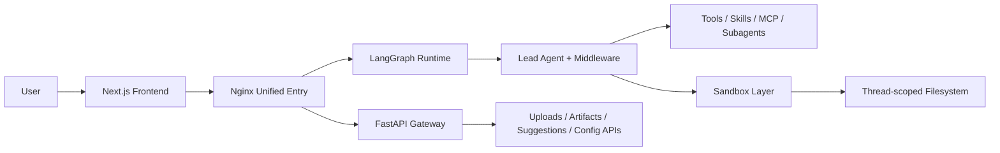
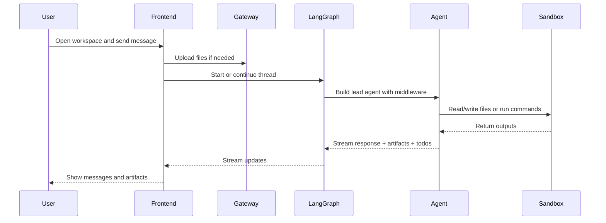
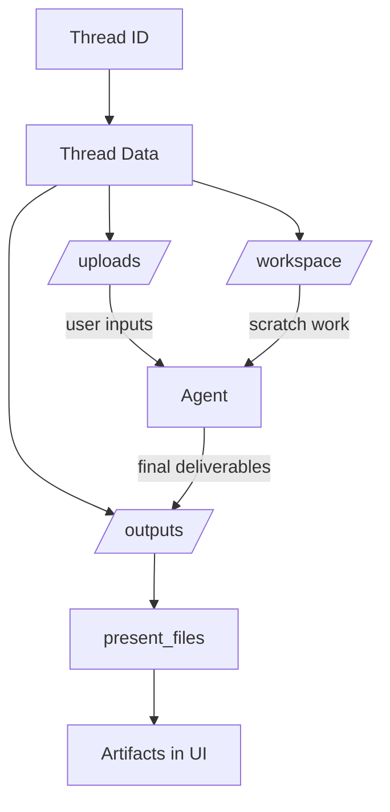
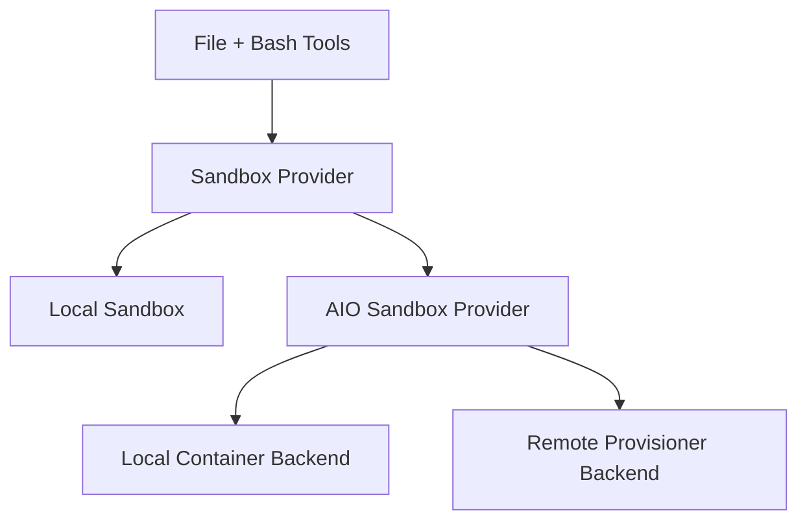
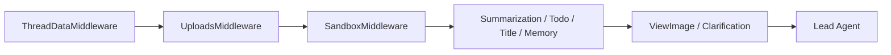

## DeerFlow High-Level Architecture Breakdown

### Purpose

This document gives a high-level, diagram-style explanation of how DeerFlow is structured and how the major components interact, with emphasis on thread flow, execution, artifacts, and user experience.

---

## 1. System landscape



### Interpretation

- The frontend is the user-facing workspace.
- Nginx makes the whole product look like a single application.
- LangGraph handles agent execution and streaming.
- The Gateway handles supporting APIs such as uploads and artifacts.
- The sandbox layer gives the agent a real execution environment.

---

## 2. Main user flow



### Interpretation

The user experiences one chat flow, but behind that flow the system coordinates file ingestion, stateful execution, artifact generation, and streamed UI updates.

---

## 3. Thread-centered file model



### Interpretation

- `uploads` contains user-provided files
- `workspace` contains internal working files
- `outputs` contains final deliverables
- only explicitly presented output files become user-facing artifacts

This is one of the cleanest concepts in the architecture.

---

## 4. Execution layer options



### Interpretation

- In local mode, execution happens on the host with path rewriting.
- In container mode, execution happens inside a sandbox container.
- In provisioner mode, sandbox lifecycle can be managed remotely.

This gives DeerFlow a strong portability model.

---

## 5. Middleware pipeline



### Interpretation

The middleware chain prepares context before the model runs. This keeps cross-cutting concerns out of the core agent loop and is one of the strongest backend design decisions.

---

## 6. Artifact delivery path

```mermaid
flowchart LR
    AG[Agent writes output file] --> OUT[/mnt/user-data/outputs]
    OUT --> PF[present_files]
    PF --> TS[Thread State: artifacts[]]
    TS --> FE[Frontend Artifact Panel]
    FE --> GW[Gateway Artifact Route]
    GW --> USER[View / Render / Download]
```

### Interpretation

The architecture deliberately separates file creation from file presentation. This keeps the user experience cleaner and makes artifact handling more explicit.

---

## 7. High-level architectural strengths

- **Thread-first design** unifies chat, files, and execution.
- **Stable virtual filesystem** makes tools portable across backends.
- **Middleware composition** keeps runtime behavior modular.
- **Artifact pipeline** turns execution results into user-visible deliverables.
- **Execution backend flexibility** supports local and more production-style deployment models.

---

## 8. High-level conclusion

At a high level, DeerFlow is best understood as a layered agent workspace:

- a chat product on the surface
- a stateful agent runtime underneath
- and a real execution/file system below that

That layered model is what gives the system both usability and power.