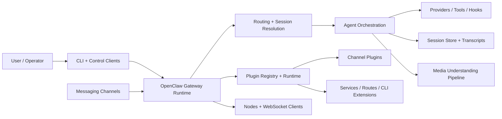
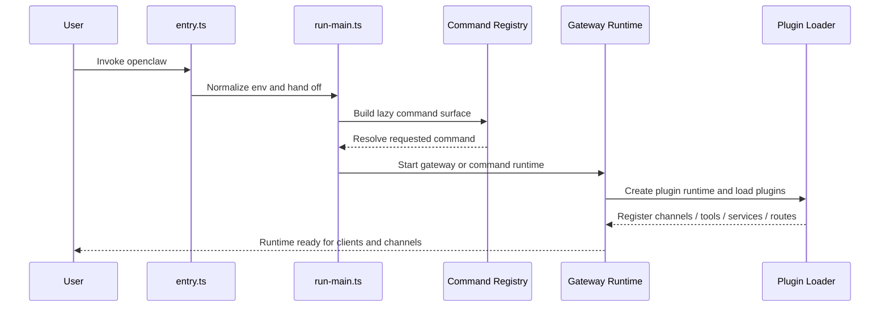
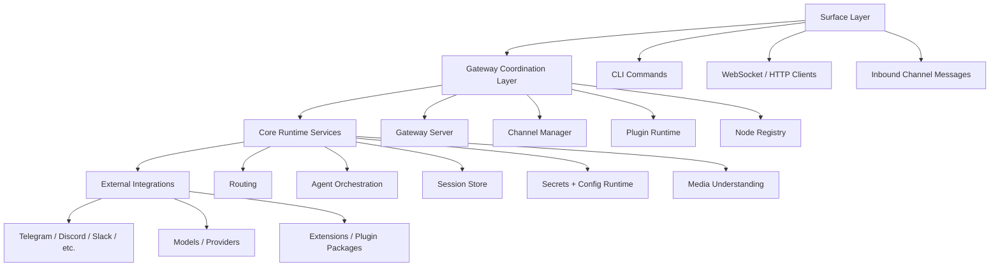
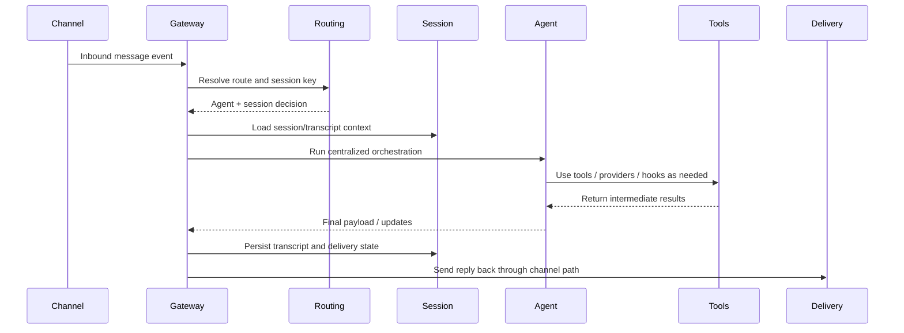
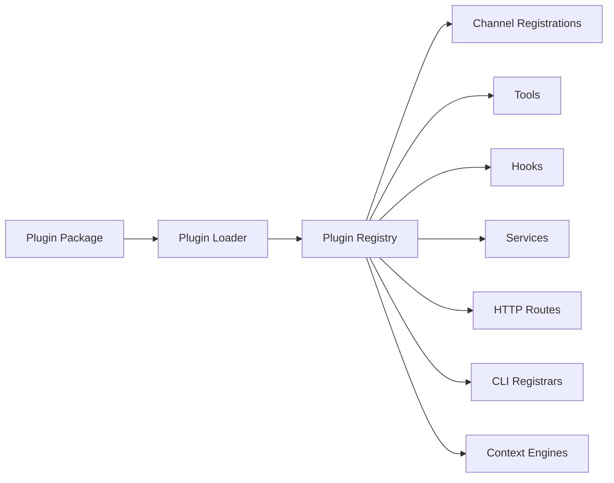
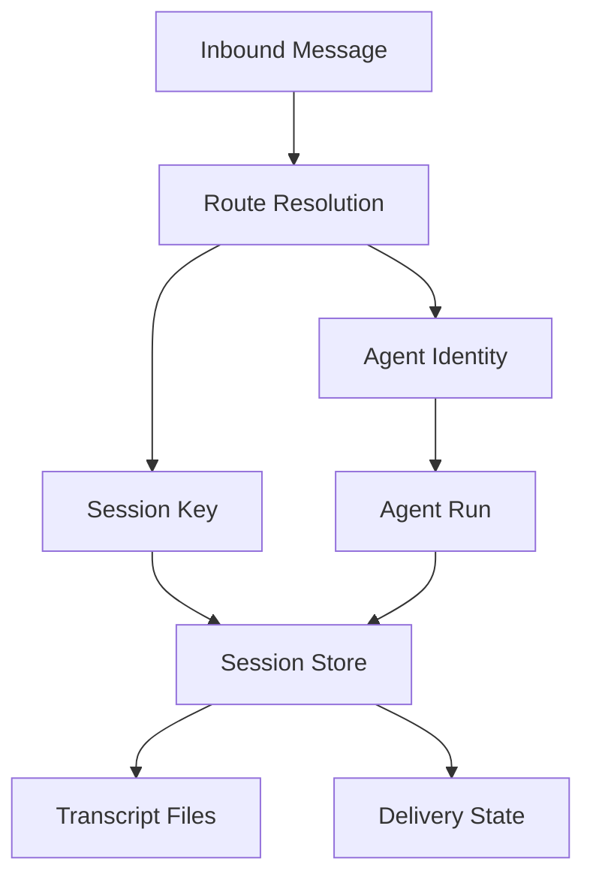

## OpenClaw High-Level Architecture Breakdown

### Purpose

This document explains OpenClaw at a high level and shows how the major layers fit together: CLI entry, Gateway runtime, channels, plugins, routing, session persistence, media understanding, and operator control surfaces.

---

## 1. System landscape

### Interpretation

- The CLI is a control surface, not the architectural center.
- The Gateway is the composition root and runtime hub.
- Routing connects inbound events to agent identity and session identity.
- Plugins provide most extensibility around channels, tools, services, and routes.
- Session persistence makes the system stateful across turns.

---

## 2. Startup flow

### Interpretation

OpenClaw startup is layered. The executable entry point normalizes the process, the CLI resolves the requested capability, and the Gateway assembles the long-lived runtime when needed.

---

## 3. Runtime layering

### Interpretation

- The surface layer receives control input.
- The gateway coordination layer owns runtime lifecycle.
- The core runtime services make routing, execution, and persistence coherent.
- External integrations remain behind channel/provider/plugin boundaries.

---

## 4. Inbound message to reply flow

### Interpretation

The key design choice is that channels do not independently own agent logic. They inject events into a shared orchestration path that is responsible for route selection, execution, persistence, and delivery.

---

## 5. Plugin-centric extension model

### Interpretation

OpenClaw is deliberately registry-driven. Most extensibility is expressed as registration into a shared runtime registry rather than custom ad-hoc code paths.

---

## 6. Session-centered state model

### Interpretation

OpenClaw is not just replying to messages. It continuously maps inputs into a persistent identity model so that future turns can inherit the right context.

---

## 7. High-level architectural strengths

- **Gateway-centered composition** keeps the runtime coherent.
- **Registry-first extensibility** supports channels, tools, and services without fragmenting the core.
- **Centralized orchestration** keeps agent behavior consistent across messaging surfaces.
- **Explicit routing/session identity** supports long-lived conversational continuity.
- **Config and secret snapshots** improve safety and operational predictability.
- **Media subsystem separation** makes multimodal behavior easier to evolve.

---

## 8. High-level conclusion

At a high level, OpenClaw is best understood as a **local-first AI messaging platform runtime**:

- a CLI and control plane at the edge
- a Gateway orchestration core in the middle
- and channels, plugins, providers, and stateful sessions underneath

That architecture is what allows OpenClaw to behave like one product while spanning many channels, execution paths, and runtime concerns.